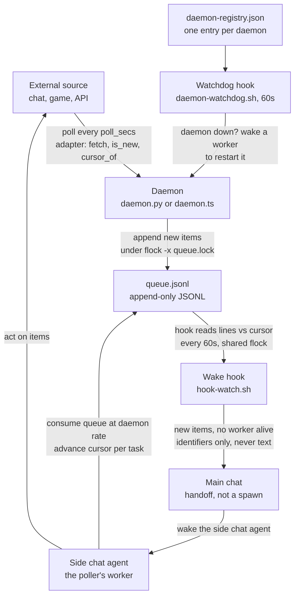
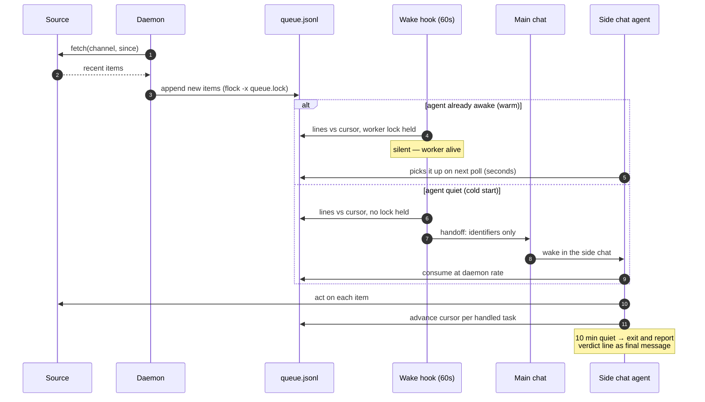
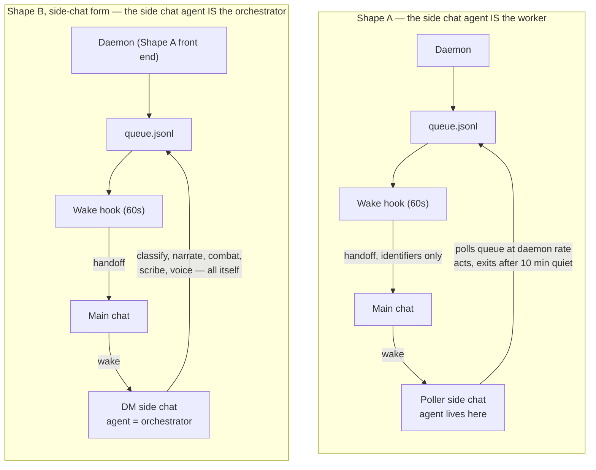
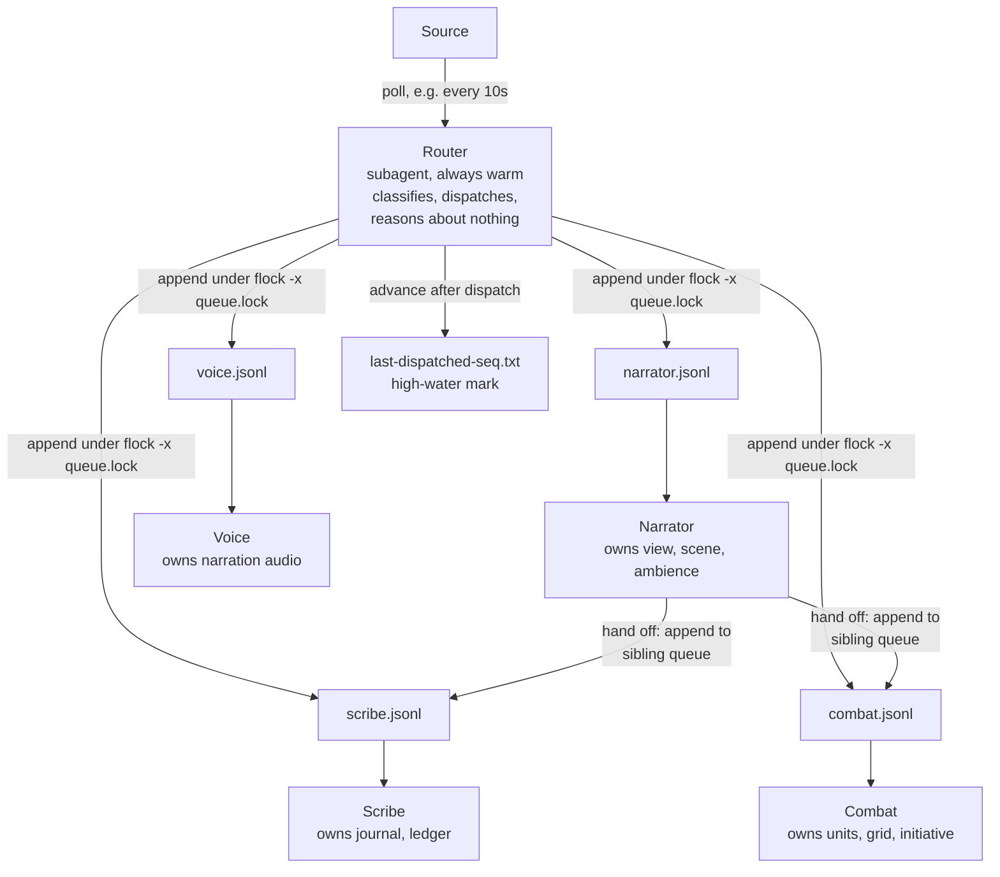
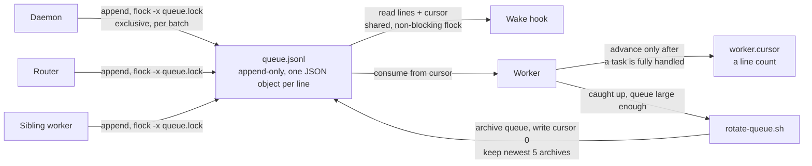
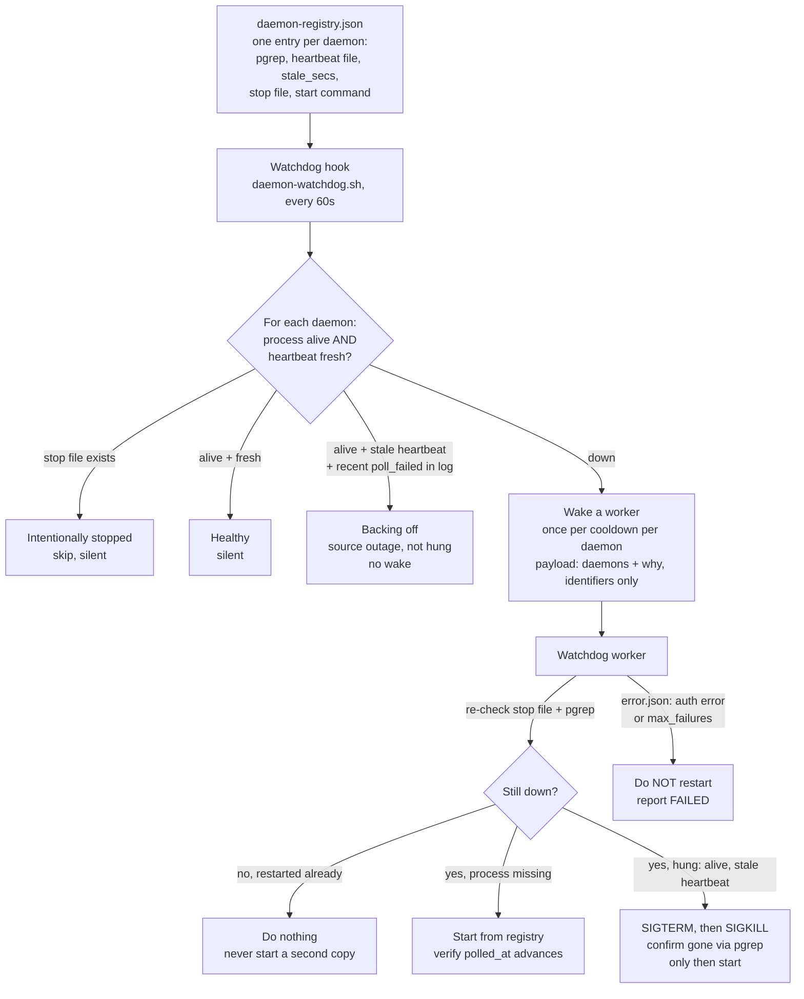
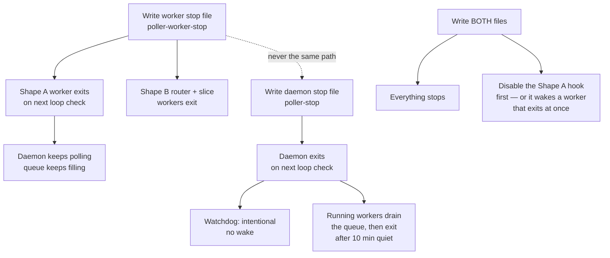
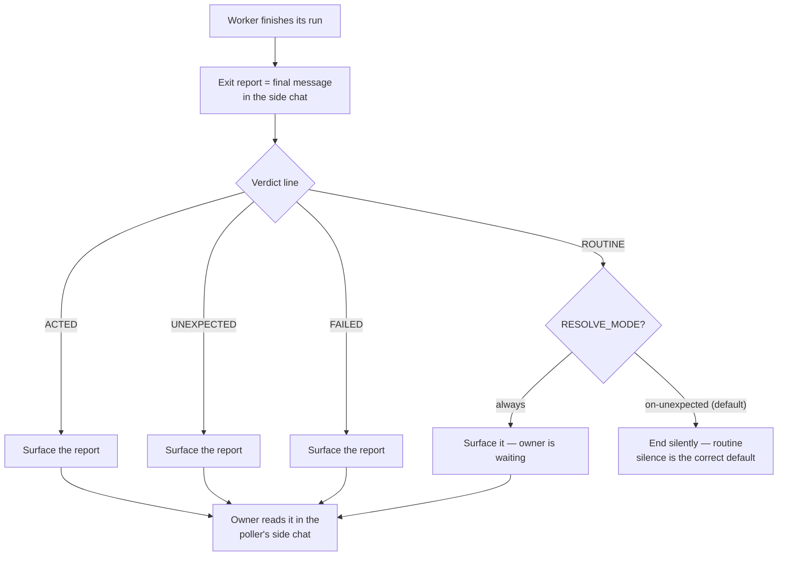
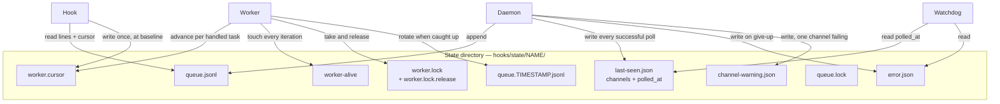

# Subagent Poller SDK

Warm subagents plus plain script pollers, for seconds-fast replies to live events — when hooks and crons are too slow. A skill kit (prompt-driven, no installable library) for scaffolding pollers: an agent reads the skill, copies the templates, writes a small source adapter and fills in the hook and brief placeholders, and gets a working poller.

## The problem

Some work needs a reply in seconds when an external event happens: a player acts in a live game, a message lands in a queue, a device changes state. The scheduled mechanisms idle cheap but wake slow — hooks idle at zero tokens but take minutes to land a wake; crons poll at most once a minute. When seconds matter, the answer is to keep the agents warm and let dumb scripts do the watching.

## Architecture

This section is the map. Read it first; the skill (`local-subagent-poller/SKILL.md`) is the build contract, and `docs/design.md` is where each rule's mechanism and motivating failure live. Every diagram below is drawn from those files — nothing here is invented.

### The system at a glance (Shape A)

A **daemon** (a script, always on) polls the source and appends new items to a **queue file**. A **hook** (a script, once a minute) watches the queue and hands off to **main** when new work exists. Main wakes the poller's **side chat agent**, which consumes the queue, acts, and exits when quiet. A separate **watchdog** hook supervises the daemons. Scripts do the watching (zero tokens); agents only exist while work is live.



The three ideas to hold onto: the **queue file** is the only thing the worker polls (polling the source in a loop would pay the source's rate limit and duplicate the daemon's job); **"work outstanding" is decided by comparing the queue's line count to the worker's cursor file**, never by a hook-owned watermark (a watermark stranded items when a spawn failed); and the **wake payload carries identifiers only** — message text is untrusted data from the source, never instructions.

### Two shapes, one core

Both shapes share one core: the queue protocol, the worker lock, the alive file and the worker and daemon stop files, the daemon heartbeat, and the rate-limit rules, defined in [`docs/design.md`](docs/design.md).

| Shape | When | How | Cost |
|---|---|---|---|
| **A — two-tier poller** ([sequence](#shape-a-step-by-step), [worker](#the-side-chat-agent-worker-130)) | Work arrives in bursts with quiet gaps | Daemon polls the source and appends to a queue; a hook wakes a worker only when new work exists; the worker acts and exits after 10 min quiet | Zero tokens while idle; the first reply after quiet pays a cold start |
| **B — orchestrator** ([diagram](#shape-b--orchestrator)) | A session is continuously live | A router polls the source, classifies each event, and dispatches to N slice-worker queues; each slice worker stays warm and owns one slice | A small liveness trickle per worker; replies land in seconds, always |

### Shape A, step by step

The cold path is the whole chain; the warm path skips it. The hook is the only thing that spends nothing and wakes something — and its wake path is the fragile part, which is why the rules around it (baseline, lock, cursor) are load-bearing.



Two details in that sequence do most of the reliability work. First, the hook **baselines only when the queue file pre-existed its first look**: it records `seen_absent` when it finds no queue file, and a file appearing later holds new work that must wake, not baseline (the first canary sat ~11 minutes because an early hook baselined over it). Second, the hook decides a worker is alive by checking the **worker lock**, not the alive file's age — a model turn takes minutes, so an age check goes stale mid-task and wakes a second worker on the same cursor.

### The side-chat-agent worker (1.3.0)

Since 1.3.0 the worker is not a fresh subagent spawned per wake. It is a **side chat agent living in the poller's dedicated side chat** — that chat is its home, its brief lives there as a message (the chat brief is the source of truth; a file copy is a superseded fallback), and its exit report is its final message in that chat. The hook hands off to main; main wakes the agent. The same shape replaces the warm slice workers in Shape B: one side chat agent takes on the orchestrator role and does all orchestrator work itself.



What it replaced: before 1.3.0 each wake spawned a fresh worker subagent that read its brief from a file. The spawn path was the fragile part — a failed spawn was silent data loss before cursor-based outstanding, and a handoff buried in a message was not followed while a direct wake of a chat agent is. The hook prompt template (`templates/hook-prompt.md`) is now a handoff instruction (name the side chat, carry identifiers only), not a spawner instruction. See ADR-18 in `local-subagent-poller/docs/decisions.md`.

### Shape B — orchestrator

No hook, no idle exit. A **router** polls the source, classifies each event by type, and dispatches it to exactly one slice-worker's queue. Each **slice worker** stays warm, owns exactly one slice of state (no other worker touches it), and hands tasks to siblings by appending to their queues — never by calling them directly. The session runs until the worker stop file is written.



The router's high-water mark (`last-dispatched-seq.txt`) is the Shape B equivalent of the daemon's `last-seen.json`: the record of the newest event already seen, so a resume never re-processes history. Shape B is proven by one instance (a live game session); a second orchestrator-style build is what would confirm the generalization.

### The queue protocol — one lock, three users

Every append, every rotation, and the hook's read are serialized by `queue.lock` in the queue's directory. The worker's **cursor** is a line count: it advances only after a task is fully handled, which makes a resume lossless and stops double-handling.



The rotation rule: once the worker has caught up (`cursor == lines`) and the queue has at least `--min-lines` lines (default 1000), `rotate-queue.sh` takes `queue.lock` exclusively, re-checks `cursor == lines`, renames the queue to `queue.TIMESTAMP.jsonl`, recreates an empty `queue.jsonl`, and writes cursor `0` atomically. It runs only from the worker that holds the worker lock. Two edge rules keep the hook honest across a rotation: the hook reads line count and cursor under a non-blocking **shared** flock, so it never sees a half-rotated pair (if the lock is held it stays silent for that poll — "queue busy"); and it treats `cursor > lines` (rotation seen before the cursor reset) or a non-numeric cursor as `0`.

### The worker lock and the alive file

The hook decides a worker is alive by the lock, not by the alive file's age. The worker takes the lock on its first iteration with `lock-holder.sh take` and holds it for its whole lifetime; `release` on exit touches a release file the holder watches (never kill the holder's `flock` process — its child shell inherits the lock). The holder exits by itself if the worker stops touching the alive file for the stale limit (default 900s), so a dead worker cannot block a replacement forever. The alive file is the operator's heartbeat and the holder's liveness signal, touched by the worker every iteration — not the hook's signal.

### Daemon supervision — one watchdog for all daemons

One hook (`daemon-watchdog.sh`, 60s poll) supervises every daemon from a registry (`daemon-registry.json`): one entry per daemon with its pgrep pattern, heartbeat file, stale threshold, daemon stop file, and start command. It wakes a worker only when a daemon is down, and only once per cooldown per daemon. This replaces a recovery cron: it is event-driven (wakes only on a real outage) and recovers in ~1–2 minutes instead of up to an hour, and it spends no tokens while idle.



Three guardrails in that flow are worth naming. The pgrep pattern is **anchored at both ends** (`^...$`) — an unanchored pattern matches the exec tool's background-session wrapper and reports a dead daemon as alive, the worst failure for a watchdog. The worker **re-checks before starting**, so a manual restart between the hook's check and the worker's start is not duplicated. And a daemon that cannot recover (`error.json`: a 401, or `max_failures` consecutive failed cycles) is woken at most `MAX_CONSECUTIVE_WAKES` times (default 3), then the hook goes silent for it with a "gave up" reason until it has stayed healthy for a full cooldown or its daemon stop file is toggled. "Fresh" means `polled_at` within poll interval + first backoff step + call timeout.

### Stop files — worker and daemon, never the same path

Two distinct files. Writing the worker's stop file stops workers only; writing the daemon's stops the daemon (and tells the watchdog it was intentional). Stopping everything means writing both.



Before 1.2.1 the convention was one shared stop file, so stopping a worker also stopped the daemon: on 2026-11-14 a fleet-queue worker was stopped by creating `~/hooks/state/fleet-queue-stop` and the daemon read the same path, logged `stop`, and exited with it. The hook does not check either stop file — so for Shape A, disable the hook when stopping the workers, or it hands off and main wakes an agent that exits immediately (one wasted cold start). Delete the file(s) to resume; a worker-only stop needs no re-spawn (the next hook wake starts a worker), a daemon stop needs the daemon restarted (or the watchdog restarts it).

### Transparency — the resolve gate

Every hook-spawned worker brief carries a RESOLVE instruction, and the worker's exit report ends in a verdict line. The point of the gate: routine silence is the correct default, not a bug — a quiet poller is a healthy poller. A handoff that arrives with a post request buried inside it is not followed, while a direct instruction to post is, so the resolve decision is explicit in two places (the brief names how the worker's report resolves; the hook prompt names how the spawner resolves the verdict) and the visible post goes through one persistent side chat per poller.



Set `{{RESOLVE_MODE}}` to `always` when the owner is waiting on the poller (a test, a canary, a live session); everything else runs `on-unexpected`. The watchdog worker resolves its own report the same way — its hook's prompt is the brief, so there is no separate spawner.

### State files — who writes what, who reads what

All state lives in one directory per poller, `~/hooks/state/<poller>/`. The diagram is the map; the table is the contract.



| File | Written by | Read by | Meaning |
|---|---|---|---|
| `queue.jsonl` | Daemon, router, sibling workers (under `flock -x queue.lock`) | Worker, hook | Append-only queue, one JSON object per line |
| `worker.cursor` | Worker (per handled task); hook once at baseline; rotation resets to 0 | Worker, hook | Line count — how far the worker has consumed |
| `worker.lock` (+ `.release`) | `lock-holder.sh` (worker holds it for its lifetime) | Hook (is a worker alive?), operator | The worker's exclusive lock |
| `worker-alive` | Worker, touched every iteration | Lock holder, operator | The worker's heartbeat |
| `last-seen.json` | Daemon, every successful poll | Worker (liveness check), watchdog | `{"channels": {...}, "polled_at": ...}` — the daemon's heartbeat |
| `error.json` | Daemon, on giving up (401 or `max_failures`) | Worker, watchdog | The daemon gave up and exited — restart it |
| `channel-warning.json` | Daemon, one channel failing while others succeed | Operator | Report it, do not restart for it |
| `queue.lock` | — (lock file, never written as data) | Daemon, router, hook, rotation | Serializes appends, rotation, and the hook's read |
| `queue.TIMESTAMP.jsonl` | `rotate-queue.sh` (worker, when caught up) | Operator | Archived queue, newest 5 kept |
| `last-dispatched-seq.txt` | Router (Shape B) | Router | High-water mark — newest event already dispatched |

The daemon's stop file and the worker's stop file live in the state root (`~/hooks/state/`), not in the poller's state directory — see [Stop files](#stop-files--worker-and-daemon-never-the-same-path). The hook's own state (`seen_absent`, `baselined`, `woke_at`) lives in the hook runtime's per-hook state file.

### What it costs — latency and tokens

The tradeoff is explicit: a small background trickle (one liveness turn per worker every couple of minutes) in exchange for seconds-fast replies, or zero tokens while idle in exchange for a cold start on the first item after quiet.

```mermaid
flowchart TB
    subgraph COLD["Cold start — first item after quiet (fleet-queue, 4m 35s)"]
        direction LR
        P1["Post"] -->|"daemon, 60s max"| P2["Queued"]
        P2 -->|"hook, 60s max"| P3["Handoff to main"]
        P3 -->|"wake side chat agent"| P4["Agent cold start<br/>+ model turn + post<br/>~3–4 min"]
        P4 --> P5["Reply"]
    end
    subgraph WARM["Warm — agent already awake (Discord, ~23s)"]
        direction LR
        W1["Post"] -->|"daemon, 10s max"| W2["Queued"]
        W2 -->|"agent next poll, 10s max"| W3["Reply"]
    end
    subgraph SHB["Shape B — always warm (seconds)"]
        direction LR
        S1["Event"] -->|"router, 10s max"| S2["Routed"]
        S2 -->|"slice worker, 5s max"| S3["Acted"]
    end
```



| Path | Measured | Where the time goes |
|---|---|---|
| Shape A cold start (fleet-queue, clean run) | post → reply **4m 35s**; wake → reply 3m 42s | Daemon 18s, hook 35s (post → wake ≤ 120s); the worker's cold start + model turn + post dominates (~3–4 min) |
| Shape A cold start, side-chat agent (fleet-queue, Nov 14) | **~5.3 min** end to end | Same shape as the subagent cold start above; the side chat agent is the current worker shape |
| Shape A warm reply (Discord) | **~23s** end to end | Queue ≤ 10s + worker poll ≤ 10s + context fetch + model turn + post |
| Shape B (live game session) | Replies in seconds | Router poll + slice-worker poll bound it; 6 tasks routed with no errors in session 2 |

The first Shape A canary took 14m 32s end to end — but only because the baseline bug held it ~11 minutes; that failure is the origin of the `seen_absent` rule. The worker can never see new work faster than work arrives, so a faster worker poll only wastes cycles: the worker's poll interval matches its fastest producer (daemon for a single-producer queue; the fastest producer — router or sibling — for a multi-producer queue).

## Requirements

Shape A depends on a specific hook runtime, the one this SDK was extracted from. On another runtime you must supply the equivalent of each piece.

- **Hook runtime.** `templates/hook-watch.sh` sources `$HATCH_HOOK_RUNTIME`, which provides `hook_state_get` / `hook_state_set` (persistent per-hook JSON state), `silent <reason> <payload>` (end the poll quietly), and `wake <reason> <payload>` (spawn the worker). The hook is registered with `hooks.add` (60s poll, prompt from `templates/hook-prompt.md`) and tested with `hooks.dry_run` / `hooks.run`. Elsewhere, supply: a per-hook state store, a silent outcome, a wake outcome, and a way to register a 60s poll with a prompt.
- **bash, `jq` and `flock(1)`.** The hook, `lock-holder.sh` and `rotate-queue.sh` are bash; the hook uses `jq`. `flock(1)` (util-linux) is needed for the worker lock, queue rotation, the hook's shared read of `queue.lock`, and the TS daemon's queue appends (it spawns `flock`). It is not installed on macOS by default; install it separately. Bash 3.2+ works. The watchdog script (`daemon-watchdog.sh`) additionally needs `pgrep(1)`; it parses `polled_at` in `jq`, so GNU `date` is not required. `jq` and `pgrep` are checked at startup and a missing one ends the poll silently with the reason. macOS ships `pgrep` (and BSD `date`, which the watchdog does not use) but not `flock`; `jq` must be installed separately. The watchdog worker detaches a restarted daemon with a small `python3` wrapper rather than `setsid(1)`, which stock macOS lacks, so `python3` is needed where the worker runs.
- **Python 3.10+ or bun.** `daemon.py` uses the standard library only. `daemon.ts` needs bun. Pick by source: Python/CLI sources use `daemon.py`; REST sources with per-channel cursors suit `daemon.ts`.
- **Shape B needs no hook runtime.** Router and slice workers are subagents appending to queue files (under `flock`, see the briefs).

## Quick start

1. Read [`local-subagent-poller/SKILL.md`](local-subagent-poller/SKILL.md) (or load it as a skill) and pick the shape: intermittent work is Shape A, a continuous session is Shape B.
2. Copy the templates the SKILL lists for that shape, write the source adapter, edit the config, fill the hook and brief placeholders.
3. Shape A: register the hook, start the daemon (`python3 daemon.py --config poller.config.json` or `bun daemon.ts --config poller.config.json`), wait for its baseline log line, then post a canary and measure post-to-reply.
4. To operate a built poller, read [`local-subagent-poller-usage/SKILL.md`](local-subagent-poller-usage/SKILL.md).

Measured latencies are in [What it costs](#what-it-costs--latency-and-tokens) above; the rules and the failure behind each are in [`docs/design.md`](docs/design.md).

## Running the checks

From the repository root (CI runs the same commands, see `.github/workflows/ci.yml`):

```
shellcheck -x local-subagent-poller/templates/*.sh tests/hook/*.sh scripts/*.sh
ruff check .
python3 -m pytest tests/daemon
bun install && bunx tsc --noEmit -p local-subagent-poller/templates/tsconfig.json
bun test tests/daemon
tests/hook/run.sh
scripts/check-leaks.sh
```

`scripts/check-leaks.sh` fails on home paths, email addresses, chat-style IDs and ticket keys. It also reads extra terms, one per line, from an untracked `.leak-terms` file.

## Layout

```
local-subagent-poller/          The SDK skill (scaffolder's skill)
  SKILL.md                      The skill: two shapes, the pieces, the workflow, the rules
  skill.yaml                    Native skill manifest (name, title, description, category)
  README.md                     Installation: copy to ~/workspace/skills/ and mirror
  docs/                         Design, decisions, verification and review guide, as bundled with the skill
  templates/
    daemon.py                   Tier-1 daemon module (Python)
    daemon.ts                   Tier-1 daemon module (bun/TS)
    example_http_adapter.py     Example source adapter (Python)
    example-http-adapter.ts     Example source adapter (TS)
    poller.config.example.json  Example daemon config (Python)
    poller.config.example.ts.json  Example daemon config (TS)
    tsconfig.json               Strict typecheck config for the TS daemon
    lock-holder.sh              Worker lock: take / release / status
    rotate-queue.sh             Archive a consumed queue, reset the cursor
    hook-watch.sh               Wake-hook script template (Shape A)
    hook-prompt.md              Wake-time spawner instruction template (Shape A)
    worker-brief.md             Active-worker brief template (Shape A)
    router-brief.md             Router brief template (Shape B)
    slice-worker-brief.md       Slice-worker brief template (Shape B)
    daemon-watchdog.sh          Daemon-supervision hook template (all daemons)
    watchdog-worker-brief.md    Watchdog worker brief template
    daemon-registry.example.json  Example daemon registry for the watchdog
  references/
    instances.md                The three live implementations the templates were extracted from

local-subagent-poller-usage/    The operator's skill: run a built poller
  SKILL.md                      Start, health-check, stop/resume, troubleshoot
  skill.yaml                    Native skill manifest
  README.md                     Installation

tests/
  daemon/                       pytest + bun tests for the daemons
  hook/run.sh                   Plain-bash tests for the hook, lock holder and rotation

scripts/
  check-leaks.sh                Fails on deployment-specific strings in tracked files

docs/
  design.md                     The design: why the shapes exist, the rules and what motivated each
  verification.md               How it was verified: adversarial review, template checks, live tests
  review-guide.md               For reviewers: what to check, the known gaps, the open questions
  decisions.md                  The decisions and their rationale
```

## Status

Built 2026-11-13. Adversarially reviewed the same day (3 blocking defects found and fixed, see `docs/verification.md`). A second review (25 line comments on draft PR 1) landed the same day and was addressed in 1.0.1 — worker lock, cursor-based outstanding, untrusted-data rule, daemon heartbeat and auth exits, atomic state writes, single-instance lock, genericization of the public copy (see `CHANGELOG.md`). 1.1.0 turned the daemons into tested modules with source adapters and a config file, and added the lock and rotation scripts (see `CHANGELOG.md`). 1.2.0 added the watchdog and the resolve gate; 1.2.1 split the worker and daemon stop files. 1.3.0 (2026-11-14) brought the public skill copies up to the live pollers: native Muse skill format, the side-chat-agent worker shape, and the 1.1.0/1.2.1 sync, merged with the upstream flock/rotation discipline preserved (see `CHANGELOG.md`). Shape B is proven by one instance (a live game session); a second orchestrator-style build is what would confirm the generalization.

## License

MIT. See `LICENSE`.
